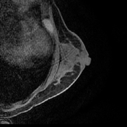
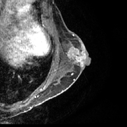
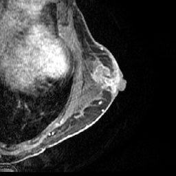

# Breast-CNN

CNN para la predicción de respuesta patológica completa (**pCR**) en cáncer de mama a partir de imágenes **DCE-MRI**.

Este repositorio contiene el desarrollo de un proyecto académico de Deep Learning cuyo objetivo es estudiar si una red neuronal convolucional puede aprender patrones asociados a la respuesta al tratamiento a partir de tres fases de una resonancia magnética dinámica con contraste.

La red genera una probabilidad de pCR para cada corte. Posteriormente, las predicciones de los cortes pertenecientes a una misma paciente se agregan para obtener una predicción a nivel de paciente.

---

## Objetivo

La **respuesta patológica completa (pCR)** indica la ausencia de enfermedad tumoral residual invasiva tras el tratamiento neoadyuvante.

El objetivo del proyecto es desarrollar un pipeline reproducible capaz de estimar la probabilidad de pCR de una paciente a partir de imágenes DCE-MRI adquiridas antes del inicio del tratamiento.

---

## Arquitectura

El proyecto utiliza una **CNN 2D desarrollada específicamente para este trabajo y entrenada desde cero**.

Cada arquitectura se describe en un fichero YAML dentro de `configs/`, de modo que puede leerse y modificarse sin tocar el código que la construye.

La arquitectura definitiva se determinará durante la fase experimental. Una vez fijada, su composición se documentará en la siguiente tabla:

| Capa / bloque | Operación | Kernel | Stride | Padding | Canales | Volumen de salida | Activación | Parámetros |
|---|---|---:|---:|---:|---:|---|---|---:|
| INPUT | — | — | — | — | 3 | 3 × 256 × 256 | — | — |
| — | — | — | — | — | — | — | — | — |
| — | — | — | — | — | — | — | — | — |
| — | — | — | — | — | — | — | — | — |
| — | — | — | — | — | — | — | — | — |
| OUTPUT | — | — | — | — | — | — | — | — |

---

## Dataset

Los datos utilizados proceden de **BreastDCEDL**, un dataset estandarizado de DCE-MRI de cáncer de mama preparado para tareas de Deep Learning ([Fridman et al., 2026](https://doi.org/10.1038/s41597-026-06589-6)).

Para este proyecto se utiliza una versión docente derivada de BreastDCEDL, formada por **1.273 pacientes con etiqueta pCR conocida**, procedentes de tres cohortes: **I-SPY1, I-SPY2 y Duke**.

| Cohorte | Train | Test | Total |
|---|---:|---:|---:|
| I-SPY1 | 104 | 35 | 139 |
| I-SPY2 | 784 | 99 | 883 |
| Duke | 209 | 42 | 251 |
| **Total** | **1.097** | **176** | **1.273** |

Los identificadores `ACRIN-6698-*` pertenecen a pacientes de la cohorte **I-SPY2** y no representan una cohorte adicional.

El conjunto contiene **12.703 cortes**: 10.945 en `train` y 1.758 en `test`.

Cada corte está representado por tres imágenes DCE-MRI de `256 × 256` píxeles correspondientes a diferentes momentos de la adquisición:

- **PRE**: antes de la administración de contraste.
- **EARLY**: fase temprana post-contraste.
- **LATE**: fase tardía post-contraste.

Cada muestra de entrada está formada por las tres fases del mismo corte:

```text
PRE + EARLY + LATE -> [3, 256, 256]
```

La etiqueta **pCR** pertenece a la paciente, por lo que todos los cortes de una misma paciente comparten la misma etiqueta.

### Organización de los datos

Las imágenes se organizan por paciente dentro de los conjuntos `train` y `test`:

```text
data/
├── train/
│   ├── ACRIN-6698-103939/
│   │   ├── ACRIN-6698-103939_z006_PRE.png
│   │   ├── ACRIN-6698-103939_z006_EARLY.png
│   │   ├── ACRIN-6698-103939_z006_LATE.png
│   │   ├── ACRIN-6698-103939_z007_PRE.png
│   │   └── ...
│   └── ...
└── test/
    ├── <patient_id>/
    └── ...
```

El identificador `zXXX` indica la posición axial del corte, mientras que `PRE`, `EARLY` y `LATE` indican la fase temporal.

### Ejemplo

Paciente `ACRIN-6698-103939`, perteneciente a **I-SPY2**, corte `z006`:

| PRE | EARLY | LATE |
|---|---|---|
|  |  |  |

### Metadatos

La información asociada a las muestras y pacientes se encuentra en:

```text
metadata/
├── samples.csv
├── patients.csv
├── excluded_patients.csv
└── statistics.json
```

`samples.csv` contiene una fila por corte y las rutas de sus tres fases.

`patients.csv` contiene una fila por paciente con la cohorte de origen, la etiqueta pCR y metainformación clínica y de adquisición.

---

## Predicción por paciente

La CNN genera inicialmente una probabilidad de pCR para cada corte:

```text
corte 1 -> 0.21
corte 2 -> 0.27
corte 3 -> 0.35
...
corte n -> 0.29
```

Como la pCR es una propiedad de la paciente, las probabilidades de todos sus cortes se agregan mediante la media:

```text
                        p1 + p2 + ... + pn
P(pCR | paciente) = -------------------------
                                 n
```

La media es el punto de partida. Si se prueba otra agregación (por ejemplo, ponderar o descartar cortes), la elección se hará con la validación interna de `train`, nunca con `test`.

La evaluación final del modelo se realiza a nivel de paciente.

---

## Uso

Requisitos: Conda, Make y Poetry `>=2.3,<3.0`.

```bash
conda env create -f environment.yml
conda activate ml-cnn
make install-mac        # o install-cpu / install-windows-cuda / install-linux-cuda / install-linux-rocm
```

Datos y análisis exploratorio:

```bash
python scripts/download_dataset.py                  # descarga las imágenes en data/
python scripts/audit_dataset.py --check-images      # comprueba metadatos e imágenes
python scripts/check_data_pipeline.py               # recorre un batch del Dataset
python scripts/explore_train.py                     # EDA de train -> artifacts/
```

El notebook `notebooks/01_eda.ipynb` presenta el análisis exploratorio.

Arquitectura:

```bash
python scripts/describe_model.py configs/model/baseline.yaml   # tabla de capas y parámetros
```

Entrenamiento (validación cruzada con los 5 `fold` de `train`; un experimento por fichero de `configs/experiment/`):

```bash
python scripts/train.py +experiment=baseline_unweighted
python scripts/train.py +experiment=baseline_weighted
```

Tests y estilo:

```bash
python -m pytest
python -m ruff check .
```

---

## Licencia y atribución

Las imágenes derivan de BreastDCEDL (Fridman et al., *Scientific Data*, 2026, [doi:10.1038/s41597-026-06589-6](https://doi.org/10.1038/s41597-026-06589-6)), construido a partir de colecciones de TCIA (I-SPY1, I-SPY2 y Duke), y se distribuyen bajo [CC BY-NC 4.0](https://creativecommons.org/licenses/by-nc/4.0/). El código propio se rige por [LICENSE](LICENSE).

El [enunciado original](documentation/Case-Breast.md) describe los requisitos del caso.

---

## Aviso

Proyecto académico y de investigación.

Los modelos y resultados obtenidos son experimentales y no tienen validez clínica.
