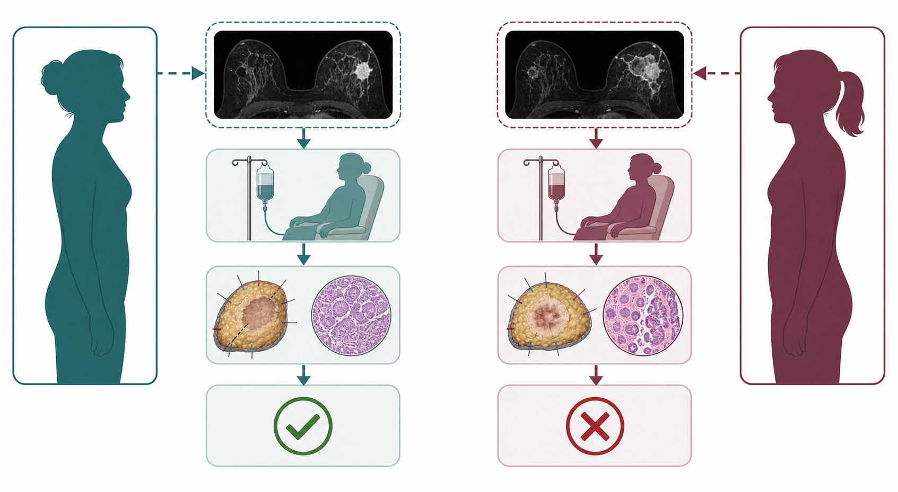
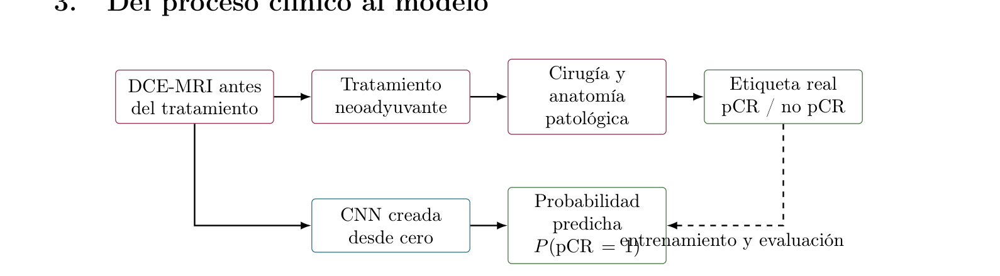
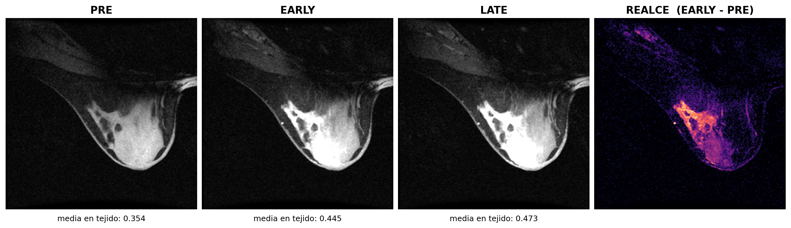
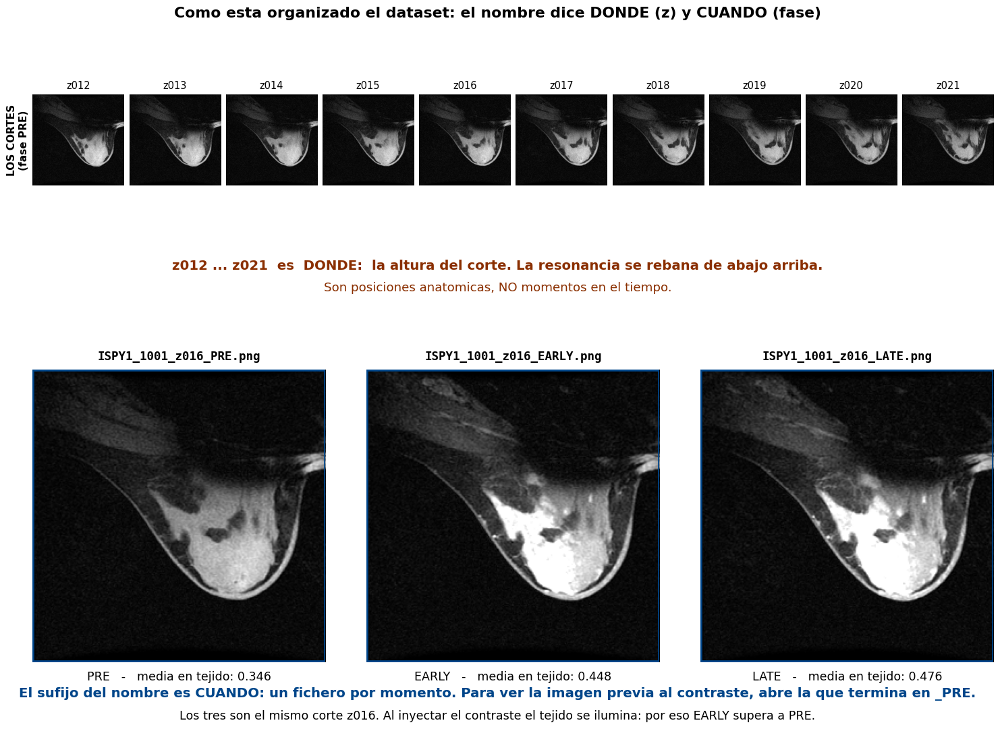

# Caso práctico BreastDCEDL

## Predicción de respuesta patológica completa con DCE-MRI

**Inteligencia Artificial y Deep Learning**

> **Reto:** construir una CNN desde cero y convertirla en una aplicación clínica demostrativa robusta.

> **Uso educativo:** este caso no autoriza decisiones médicas, reidentificación, diagnóstico ni recomendaciones terapéuticas.

## 1. Por qué se estudia este problema

El cáncer de mama no es una única enfermedad: distintos tumores presentan características biológicas y respuestas al tratamiento diferentes. En pacientes seleccionadas, el equipo médico administra tratamiento neoadyuvante, es decir, tratamiento sistémico antes de la cirugía. Este enfoque permite reducir el tumor, tratar precozmente enfermedad microscópica y observar si el tumor responde.

Sin embargo, no todas las pacientes responden igual. Poder estimar la respuesta antes de iniciar el tratamiento es un problema importante de investigación: podría ayudar en el futuro a estratificar riesgo, diseñar ensayos, investigar tratamientos personalizados y detectar grupos con baja probabilidad de respuesta.

## 2. Qué significa realmente pCR

Las siglas **pCR** vienen de *pathological Complete Response*; en español, respuesta patológica completa. Primero se administra el tratamiento; después se extrae tejido mediante cirugía o biopsia; finalmente, un especialista en anatomía patológica observa ese tejido al microscopio y busca células cancerosas residuales.

En este caso, pCR significa que después del tratamiento no se encuentra cáncer invasivo residual en el tejido evaluado de la mama y los ganglios regionales, según la definición utilizada por el estudio. No basta con que el tumor parezca haber desaparecido en una resonancia: la respuesta se determina estudiando tejido [^3].

La variable utilizada por el modelo es:

$$
y = 1 \Longleftrightarrow \mathrm{pCR}, \qquad y = 0 \Longleftrightarrow \mathrm{no\ pCR}.
$$

Una pCR positiva es un resultado favorable del tratamiento, no que «el cáncer sea positivo». Por el contrario, no pCR significa que queda enfermedad invasiva residual, aunque la etiqueta binaria no expresa cuánta.

Una predicción de `0,82` significa que el modelo estima $P(\mathrm{pCR}=1)=0,82$ para esa entrada. **No** significa un 82 % de supervivencia o de curación, y mucho menos demuestra que pueda evitarse una operación. La pCR es un indicador temprano de respuesta y una variable de investigación; su interpretación depende del subtipo tumoral y el contexto clínico. La aplicación debe mostrar incertidumbre y limitaciones, no una conclusión terapéutica.

### 2.1. Qué sucede si la paciente se opera

Después del tratamiento neoadyuvante se realiza la cirugía prevista. El tejido extraído permite comprobar qué ha ocurrido: si no se encuentra cáncer invasivo residual, se registra pCR; si todavía se encuentran células de cáncer invasivo, se registra no pCR. La cirugía sigue teniendo funciones de tratamiento local y evaluación patológica, y una predicción de una red neuronal no las sustituye.

Alcanzar pCR suele asociarse con un pronóstico más favorable en determinados subtipos de cáncer de mama. Aun así, no equivale a curación garantizada: el seguimiento médico continúa y las decisiones posteriores dependen de muchos datos. Cuando queda enfermedad residual, el equipo médico conoce mejor cuánto tumor ha resistido; esa información puede influir en la valoración del riesgo y tratamiento posterior. El modelo de esta práctica no decide nada de ello.

### 2.2. Qué sucede si no se opera

Sin tejido suficiente mediante cirugía o biopsia adecuada, no puede confirmarse la respuesta patológica completa de la misma forma. Una resonancia puede sugerir que el tumor ha desaparecido y aun así pueden quedar focos microscópicos que la imagen no detecte.

Por ello, una probabilidad alta calculada por la aplicación no debe recomendar que una paciente no se opere. La posibilidad de reducir u omitir cirugía se investiga en estudios clínicos muy controlados y requiere evidencia adicional, protocolos específicos y decisiones de equipos médicos especializados. No es una conclusión de este ejercicio.

### 2.3. Cómo aprende la CNN

La DCE-MRI se realiza **antes** del tratamiento, cuando la respuesta todavía no se conoce. Después llega el tratamiento neoadyuvante y, más tarde, se obtiene la etiqueta real al estudiar el tejido. La CNN aprende de casos anteriores a relacionar la imagen inicial con el resultado posterior; para una paciente nueva solo produce una estimación, no observa el futuro.

Una probabilidad alta no garantiza pCR y una baja no la excluye. Con un umbral de 0,50 pueden existir verdaderos positivos, verdaderos negativos, falsos positivos y falsos negativos. Deben estudiarse calibración, sensibilidad, especificidad e intervalo de incertidumbre además de ROC-AUC. El umbral no debe escogerse mirando el conjunto de test.

### 2.4. Dos ejemplos hipotéticos

**Ejemplo A - estimación alta.** La aplicación devuelve $P(\mathrm{pCR}=1)=0,84$. La paciente recibe el tratamiento previsto y se opera; en el estudio patológico no se encuentra enfermedad invasiva residual según la definición del dataset. El resultado es pCR y la predicción habría sido un verdadero positivo. En investigación, una estimación así podría ayudar a planificar seguimiento, estratificar un ensayo o informar una conversación multidisciplinar. No demuestra que la cirugía fuese innecesaria: la cirugía y la anatomía patológica son las que confirman la respuesta.

**Ejemplo B - estimación baja.** La aplicación devuelve $P(\mathrm{pCR}=1)=0,18$. Tras el tratamiento y la cirugía se identifica tumor residual: el resultado es no pCR, un verdadero negativo respecto de la clase pCR. Si un modelo estuviera validado prospectivamente, una señal de baja respuesta podría investigarse para intensificar la monitorización, incluir a la paciente en un ensayo o estudiar alternativas. Este ejercicio no aporta esa validación ni debe producir cambios terapéuticos automáticos.



También son posibles los dos errores: estimación alta con tumor residual (falso positivo) y estimación baja en una paciente que finalmente alcanza pCR (falso negativo). Deben explicarse las consecuencias de ambos; la probabilidad no debe presentarse como certeza.

## 3. Del proceso clínico al modelo



## 4. Qué aporta la DCE-MRI

La resonancia magnética dinámica con contraste (DCE-MRI) adquiere varias imágenes del mismo tejido a lo largo del tiempo. El contraste modifica la intensidad según la perfusión y permeabilidad vascular. BreastDCEDL MinCrop proporciona tres fases centradas en el tumor:

- **PRE:** antes de administrar contraste.
- **EARLY:** fase postcontraste temprana.
- **LATE:** fase postcontraste tardía.

Las fases se alinean anatómicamente y se apilan como canales de un tensor $3 \times 256 \times 256$. La CNN puede aprender conjuntamente forma, textura y cambios de realce, pero también artefactos o diferencias entre cohortes; esto debe investigarse críticamente.

Cada fase se entrega como PNG independiente en escala de grises, con `_PRE`, `_EARLY` o `_LATE` en el nombre. Se descartó un único PNG en color (R=PRE, G=EARLY, B=LATE): ocuparía lo mismo, ocultaría que contiene tres instantes distintos y obligaría a consultar la documentación para saber cuál es la imagen precontraste.

El sufijo `z012` indica **dónde** (la altura del corte axial), mientras que el sufijo de fase indica **cuándo**. Cortes consecutivos no son instantes consecutivos. Los canales no son colores: no se debe aplicar normalización de ImageNet, aumentado de color ni `ImageFolder`. Cualquier transformación geométrica debe aplicarse a las tres fases a la vez; desalinearlas destruye la información de realce.



## 5. Dataset BreastDCEDL

El caso se basa en BreastDCEDL, descrito por Fridman y colaboradores [^1]. Integra DCE-MRI de I-SPY1, I-SPY2 y Duke; estandariza volúmenes NIfTI, variables clínicas y particiones reproducibles. La versión MinCrop recorta el entorno tumoral a $256 \times 256$ y conserva PRE, EARLY y LATE.

El conjunto completo incluye aproximadamente 2.070 pacientes. Para pCR hay unas 1.452 etiquetas conocidas: 428 positivas y 1.024 negativas. Hay un desbalance relevante; una *accuracy* alta puede ocultar sensibilidad insuficiente.

El dataset docente deriva aproximadamente diez cortes relevantes por paciente. En I-SPY1 e I-SPY2 se priorizan cortes de mayor superficie tumoral en la máscara 3D. Duke no dispone de segmentación completa: se eligen cortes centrales dentro de los límites tumorales publicados entre `mask_start` y `mask_end`. Esta diferencia entre cohortes es una posible fuente de sesgo.

Cada fase se almacena como PNG de 8 bits, en escala de grises y $256 \times 256$, en:

```text
dataset/<split>/<patient_id>/<sample_id>_<FASE>.png
```

Los ficheros se agrupan por paciente para hacer explícita la unidad estadística. Cada fichero se carga como `[256, 256]` en `uint8`; se apilan PRE, EARLY y LATE, en ese orden, y se divide por 255 para obtener `[3, 256, 256]`.

Las intensidades se recortaron a los percentiles 1 y 99 calculados conjuntamente sobre las tres fases, y se escalaron a $[0,1]$ con esa única ventana. Compartir la ventana permite que `EARLY − PRE` represente realce de contraste. Si cada fase se normalizara por separado, la inyección elevaría su propio percentil 99 y la intensidad media de EARLY resultaría inferior a PRE, produciendo un realce negativo físicamente imposible. El paso a 8 bits aplica después una escala fija e idéntica a todos los cortes: conserva esa normalización y solo la discretiza.

El orden puede verificarse mediante fisiología: tras la inyección, el tejido se ilumina y la intensidad media debe cumplir `PRE < EARLY`. Medido sobre 120 pacientes, sucede en el 100 % de los casos. En cambio, LATE supera a EARLY solo en el 83 %: el descenso restante es *washout*, patrón de curva de realce asociado en clínica a lesiones sospechosas y potencialmente útil para el modelo. El error de cuantización de `EARLY − PRE` es $1/255$, unas 32 veces menor que la mediana del realce medido dentro del tejido, por lo que no compromete la señal de interés.

`samples.csv` incluye `sample_id`, `patient_id`, `split`, las tres rutas (`path_pre`, `path_early`, `path_late`), `slice_index`, `fold` y etiqueta cuando está disponible.



## 6. Separación y evaluación

La unidad estadística es la **paciente**, no el corte. Ningún `patient_id` puede aparecer en más de un *split*; de otro modo habría *data leakage*, pues el modelo reconocería anatomía de una paciente vista en entrenamiento.

| Conjunto | Quién lo recibe | Etiqueta pCR |
| --- | --- | --- |
| `train` | alumnado | sí |
| `validation` | solo profesorado | sí |
| `test` | alumnado, para evaluación final | sí |

El alumnado recibe `train` y `test` con etiquetas. Debe usar `test` para métricas finales y matriz de confusión, pero no para ajustar modelo o hiperparámetros. El profesorado conserva `validation` como conjunto privado para la evaluación en directo. Para ajustar hiperparámetros se puede crear una partición interna de `train`, también por paciente.

La edición local generada contiene 1.450 pacientes y 14.470 cortes: 1.097 pacientes en `train`, 177 en la validación privada y 176 en `test`. Se excluyeron dos pacientes Duke porque el volumen de fase tardía indicado en metadatos no estaba presente; la exclusión está registrada en `excluded_patients.csv`. Puede haber menos de diez cortes en volúmenes con una región axial disponible muy corta.

## 7. Objetivo técnico obligatorio

Construir una **CNN 2D completamente desde cero con PyTorch**. No se permiten ResNet, EfficientNet, VGG, DenseNet, modelos preentrenados ni *transfer learning*. La salida será un único *logit* y durante entrenamiento se utilizará `BCEWithLogitsLoss`. Deben compararse pérdida normal y ponderada:

$$
\mathrm{pos\_weight} = N_0 / N_1.
$$

La arquitectura, inicialización, regularización, optimizador, tasa de aprendizaje, tamaño de lote, épocas, semilla y criterio de parada deben justificarse y guardarse.

## 8. Uso recomendado de GPU

Se recomienda GPU porque las convoluciones pueden ser costosas, aunque no es obligatoria. Si se usa, el informe debe indicar dispositivo, versión del entorno, memoria máxima, tiempo por época, tiempo total y tamaño de lote. Puede compararse una ejecución corta en CPU y GPU, calculando:

$$
\mathrm{speedup} = t_{CPU} / t_{GPU}.
$$

## 9. Aplicación web final

Además del experimento, desarrollar una aplicación web robusta con Streamlit, Gradio o equivalente. Debe estar desplegada y disponible mediante URL durante la exposición; no se acepta que funcione solo en el ordenador local.

Debe cargar las tres fases de un corte del conjunto, o permitir seleccionar un ejemplo, y mostrar PRE, EARLY y LATE por separado además del mapa de realce. Tras validar forma, tipo y valores, debe ejecutar el modelo y mostrar:

- Probabilidad de pCR y clase según el umbral elegido.
- Umbral usado y versión o *checksum* del modelo.
- Dispositivo de inferencia y tiempo de respuesta.
- Parámetros principales de entrenamiento y métricas internas.
- Mensajes claros ante archivos corruptos, imágenes no PNG de $256 \times 256$, o fases ausentes o duplicadas.
- Aviso visible de uso educativo, incertidumbre y ausencia de validez clínica.

No debe aceptar rutas arbitrarias del sistema ni ejecutar contenido subido; debe limitar tamaño y formato. La predicción se ejecuta con `model.eval()` y sin gradientes, y ha de ser reproducible. La validación privada del profesor y sus etiquetas no pueden incluirse en un repositorio público ni en la aplicación.

## 10. Trabajo individual y publicación

El caso es individual: cada estudiante entrena su modelo, toma decisiones, desarrolla la aplicación y defiende resultados. La autoría del repositorio y aplicación debe corresponder al estudiante.

Puede publicarse en un repositorio personal con código, configuración, pesos, informe, cinco diapositivas y enlace web. Puede incluir ejemplos del dataset si conserva la licencia CC BY-NC 4.0, atribución a BreastDCEDL y referencias originales. No se pueden publicar etiquetas privadas, validación del profesor ni ficheros de verdad terreno. Para datos grandes se recomiendan *releases* o almacenamiento específico, no el historial habitual de Git.

## 11. Presentación en clase

La exposición debe contener exactamente cinco diapositivas:

1. Problema clínico, significado de pCR y objetivo del proyecto.
2. Preparación de datos, separación por paciente y análisis de clases.
3. Arquitectura de la CNN desde cero, con tamaños y parámetros.
4. Entrenamiento, decisiones tomadas y resultados internos.
5. Aplicación web, demostración, limitaciones y conclusiones.

Las diapositivas deben explicar la solución del estudiante; no ser copia del código ni una sucesión de capturas sin análisis. Se debe poder responder preguntas sobre arquitectura y proceso de entrenamiento.

## 12. Evaluación de la aplicación

El profesorado seleccionará al azar cinco muestras de la validación privada, pertenecientes a cinco pacientes distintos, durante la sesión o justo antes. El estudiante no conocerá previamente las muestras ni sus etiquetas.

Las cinco muestras se cargarán una por una durante la defensa. La aplicación debe procesarlas sin modificar código, reentrenar ni reiniciar el despliegue. Para cada muestra se guardarán probabilidad, umbral y clase predicha; después el profesor revelará la etiqueta real y registrará el resultado.

Se comprobará además que la predicción coincida con el pipeline, que entrenamiento e inferencia no tengan normalización distinta y que los errores se gestionen adecuadamente. Cinco muestras no bastan para estimar rendimiento clínico fiable: esta prueba evalúa principalmente que la aplicación funcione con datos nuevos y que las predicciones sean reproducibles. El profesorado podrá calcular métricas por separado sobre un conjunto oculto mayor.

## 13. Plan de trabajo y entregables

1. Auditar pacientes, clases, canales y rangos; visualizar ejemplos.
2. Construir y justificar la CNN desde cero.
3. Entrenar *baselines* y estudiar desbalance, *overfitting* y umbral.
4. Fijar el modelo con `train` y una validación interna separada por paciente.
5. Implementar y probar la aplicación con entradas válidas e inválidas.
6. Entregar repositorio reproducible, pesos, configuración y URL de la aplicación.
7. Preparar cinco diapositivas y realizar la exposición.
8. Completar la evaluación en directo con cinco muestras privadas aleatorias.

## 14. Preguntas para la discusión

- ¿Qué error es más relevante en este escenario y por qué? ¿Cambia según el uso previsto?
- ¿La red aprende biología tumoral o diferencias entre cohortes?
- ¿Cómo afecta tener diez observaciones correlacionadas por paciente?
- ¿Está calibrada la probabilidad?
- ¿Qué evidencia faltaría para estudiar utilidad clínica, equidad y generalización externa?

## 15. Ética, límites y licencia

Las imágenes están desidentificadas para docencia e investigación. Deben conservarse atribución y licencia CC BY-NC 4.0. Un buen resultado retrospectivo no demuestra seguridad, causalidad ni utilidad clínica prospectiva.

## Referencias

[^1]: N. Fridman et al., «BreastDCEDL: A standardized deep learning-ready breast DCE-MRI dataset of 2,070 patients», *Scientific Data*, 2026. DOI: [10.1038/s41597-026-06589-6](https://doi.org/10.1038/s41597-026-06589-6).
[^2]: N. Fridman et al., *BreastDCEDL: A Deep Learning-Ready Breast DCE-MRI Dataset*, Zenodo. DOI: [10.5281/zenodo.18114231](https://doi.org/10.5281/zenodo.18114231).
[^3]: National Cancer Institute, «Pathologic complete response», *Dictionary of Cancer Terms*. <https://www.cancer.gov/publications/dictionaries/cancer-terms/def/pathologic-complete-response>.
[^4]: U.S. Food and Drug Administration, «Pathological Complete Response in Neoadjuvant Treatment of High-Risk Early-Stage Breast Cancer», 2020. <https://www.fda.gov/regulatory-information/search-fda-guidance-documents/pathological-complete-response-neoadjuvant-treatment-high-risk-early-stage-breast-cancer>.
